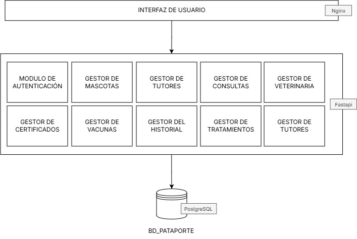

# Pataporte

> **Primer hito local preparado:** consultá [inicio y pruebas](docs/primer-hito.md) y la [guía interactiva AWS](docs/guia-despliegue-aws.html).
>
> Inicio: `python3 scripts/init_local.py`, luego `docker compose up -d --build`.
> Web: http://localhost:8085 · Correos de prueba: http://localhost:8025.
> Ensayo completo: `python3 scripts/check_local.py`.
> CI y CloudFormation están preparados en el repositorio; el despliegue AWS sigue pendiente.

Aplicación web para la gestión del historial médico de mascotas. Permite a tutores registrar sus animales, y a organizaciones veterinarias llevar el registro de consultas, tratamientos y vacunas con certificación digital.

Proyecto desarrollado para Ingeniería de Software II.

---

## Tabla de contenido

- [Tecnologías](#tecnologías)
- [Arquitectura](#arquitectura)
- [Funcionalidades](#funcionalidades)
- [Estructura del proyecto](#estructura-del-proyecto)
- [Instalación y ejecución](#instalación-y-ejecución)
- [Variables de entorno](#variables-de-entorno)
- [Documentación de la API](#documentación-de-la-api)

---

## Tecnologías

**Backend**

- Python 3.11 + FastAPI
- PostgreSQL 15 con SQLAlchemy 2 (ORM); Alembic instalado, migraciones pendientes
- Autenticación JWT (PyJWT + bcrypt)
- Envío de correos (verificación, recuperación y PDF), configurable por SMTP
- RabbitMQ y worker para correos; Mailpit como buzón local de prueba

**Frontend**

- HTML5 + CSS + JavaScript vanilla
- Servido por Nginx

**Infraestructura**

- Docker y Docker Compose

---

## Arquitectura



---

## Funcionalidades

- Registro y autenticación de tutores y organizaciones veterinarias con verificación de correo
- Recuperación de contraseña por correo
- Gestión de mascotas: crear, ver y editar perfil (nombre, fecha de nacimiento, sexo, especie, raza, foto)
- Registro de consultas veterinarias con diagnóstico y notas de tratamiento
- Seguimiento de tratamientos activos con fechas de inicio y fin
- Esquema de vacunación con tipos predefinidos (Antirrábica, Moquillo, Parvovirus, Triple Felina)
- Certificados digitales de vacunación con hash de verificación, estados y flujo de revisión
- Historial médico unificado con consultas y tratamientos

---

## Estructura del proyecto

```
pataporte/
├── backend/
│   ├── config/         # Configuración de base de datos y settings
│   ├── routers/        # Endpoints de la API agrupados por dominio
│   ├── schemas/        # Modelos Pydantic (validación de entrada/salida)
│   ├── services/       # Lógica de negocio
│   ├── utils/          # Utilidades compartidas
│   ├── main.py         # Inicialización de la app FastAPI
│   ├── requirements.txt
│   └── Dockerfile
├── frontend/
│   ├── pages/          # Páginas HTML
│   ├── js/             # Módulos JavaScript
│   ├── index.html
│   └── Dockerfile
├── .env_example        # Plantilla de variables de entorno
└── docker-compose.yml
```

---

## Instalación y ejecución

### Requisitos previos

- [Docker](https://docs.docker.com/get-docker/) y Docker Compose instalados
- Crear archivo con las variables de entorno, asegurarse de que el nombre incluya el punto: ".env"

### Pasos

1. Clonar el repositorio:

   ```bash
   git clone <url-del-repositorio>
   cd pataporte
   ```

2. Crear el archivo de entorno a partir de la plantilla:

   ```bash
   python3 scripts/init_local.py
   ```

3. El generador configura claves locales y Mailpit. Si `.env` ya existía, se conserva: revisar los campos nuevos de SMTP y RabbitMQ. Ver [el primer hito](docs/primer-hito.md).

4. Levantar los servicios:

   ```bash
   docker compose up -d --build
   ```

Una vez levantados:

| Servicio      | URL                        |
| ------------- | -------------------------- |
| Frontend      | http://localhost:8085      |
| Backend       | http://localhost:8000      |
| API Docs      | http://localhost:8000/docs |
| Correo local  | http://localhost:8025      |
| Base de datos | Solo dentro de Docker     |

---

## Variables de entorno

| Variable                      | Descripción                                       |
| ----------------------------- | ------------------------------------------------- |
| `DB_USER`                     | Usuario de PostgreSQL                             |
| `DB_PASSWORD`                 | Contraseña de PostgreSQL                          |
| `DB_NAME`                     | Nombre de la base de datos                        |
| `DATABASE_URL`                | URL de conexión completa para FastAPI             |
| `SECRET_KEY`                  | Clave secreta para firmar tokens JWT              |
| `ALGORITHM`                   | Algoritmo JWT (por defecto `HS256`)               |
| `ACCESS_TOKEN_EXPIRE_MINUTES` | Duración del token de acceso en minutos           |
| `MAIL_USERNAME`               | Usuario del correo para envío de emails           |
| `MAIL_PASSWORD`               | Contraseña de aplicación del correo               |
| `MAIL_FROM`                   | Dirección remitente de los correos                |
| `ENVIRONMENT`                 | Entorno de ejecución (`development`/`production`) |

---

## Documentación de la API

FastAPI genera documentación interactiva automáticamente:

- **Swagger UI**: http://localhost:8000/docs
- **ReDoc**: http://localhost:8000/redoc
