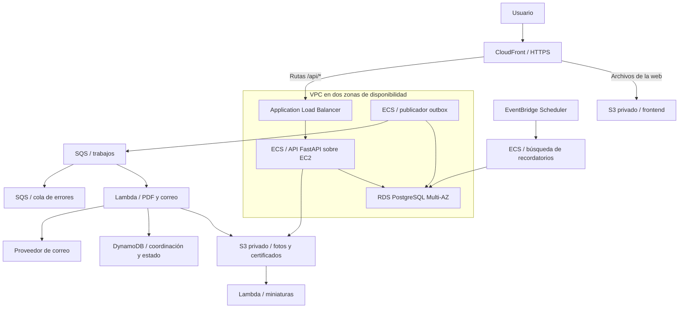

# PATAPORTE en AWS: guía de implementación y defensa

Fecha de preparación: 25 de octubre de 2026.

Esta guía explica cómo llevar la aplicación actual a una arquitectura reproducible, escalable y observable, utilizando los principales bloques trabajados en el curso. Incluye decisiones, orden de implementación, ejemplos y criterios para comprobar cada etapa.

**Estado:** es una guía de trabajo para la arquitectura completa, no un despliegue AWS ya realizado. El primer hito local (Compose, buzón de pruebas, controles iniciales, CI y plantilla de red) está implementado; consultar [estado y ejecución del primer hito](primer-hito.md). El resto de los archivos y cambios propuestos deben implementarse por etapas. Los fragmentos identificados como ejemplos no constituyen plantillas completas. No se han comprobado permisos, cuotas ni presupuesto de una cuenta AWS.

## Cómo usar esta guía

**Punto de partida disponible:** ver [primer hito local](primer-hito.md) para iniciar la aplicación y sus pruebas, conocer los cambios y revisar lo pendiente.

Trabajen por etapas. En cada una se indica qué construir, por qué y qué evidencia permite darla por terminada. Primero consigan un recorrido funcional completo; luego agreguen elasticidad y recuperación; finalmente incorporen las extensiones.

La entrega del informe es el **9 de noviembre de 2026** y las fechas comunicadas para la defensa son **11 o 16 de noviembre**, pendientes de confirmación. Esta guía de implementación puede ser extensa. El informe final de unas diez páginas debe resumir decisiones y resultados, con enlaces al repositorio.

Convenciones:

- Los comandos se ejecutan desde la raíz de `pataporte-aws`, salvo que se indique otro lugar.
- `infra/`, `scripts/`, `workers/` y los workflows nombrados son **archivos a crear**, no archivos que ya existen.
- Las variables y los dominios con `example.com` son ejemplos que deben reemplazar.
- Los valores de CPU, memoria, concurrencia y alarmas son puntos de partida propuestos; deben ajustarse con mediciones.
- Los comandos de AWS incluidos son instrucciones para el equipo. La preparación de esta guía no los ejecutó.

Lectura sugerida: todos leen las secciones 1 a 4; después cada responsable trabaja sus componentes. Los tres participan en las secciones 13 a 17.

**Ruta de implementación:** permisos y contratos → correcciones locales → infraestructura base → primera versión funcional → eventos confiables → pipeline → pruebas → extensión regional.

## 1. Qué vamos a construir y por qué

### 1.1 Arquitectura elegida

Mantendremos FastAPI y PostgreSQL. La adaptación se concentra en sacar el estado del contenedor, automatizar despliegues y desacoplar trabajos lentos.



El diagrama resume caminos de datos; IAM, Secrets Manager, CloudWatch, ECR y CloudFormation atraviesan varios componentes y se detallan más adelante. EventBridge Scheduler ejecutará una tarea ECS programada para consultar RDS y crear trabajos en la outbox. El publicador enviará esos trabajos a SQS.

La API tendrá al menos dos tareas distribuidas en dos zonas. Los servidores EC2 se crearán con un Launch Template y un Auto Scaling Group. ECS decidirá dónde ejecutar los contenedores. Dos zonas ofrecen tolerancia a fallos zonales; una segunda región requiere medidas adicionales.

### 1.2 Por qué ECS sobre EC2

ECS sobre EC2 permite aplicar conjuntamente Docker, ECR, ECS, AMI, Launch Template, EBS y Auto Scaling. Tiene un costo operativo: el equipo administra los hosts, sus actualizaciones y su capacidad. Fargate es una alternativa válida si el tiempo o las restricciones del laboratorio hacen preferible delegar esos hosts.

Hay dos decisiones de escalado diferentes: cuántas tareas requiere la API y cuántos hosts necesitan esas tareas. El primero es ECS Service Auto Scaling; el segundo se conecta al ASG mediante un capacity provider. Documenten ambos. [AWS: capacity providers de ECS](https://docs.aws.amazon.com/AmazonECS/latest/developerguide/asg-capacity-providers.html).

### 1.3 Alcance por niveles

| Nivel | Resultado |
|---|---|
| Base funcional | Usuarios, mascotas y certificados funcionan en AWS; red, RDS, S3 y ECS están definidos en CloudFormation. |
| Entrega principal | Pipeline, dos zonas, escalado, outbox, SQS/Lambda/DynamoDB, alarmas y pruebas de recuperación. |
| Extensiones | Recordatorios de vacunas, miniaturas y recuperación entre regiones. |

El objetivo es cubrir tecnologías con una razón verificable. PostgreSQL y MySQL son alternativas de motor; para esta aplicación elegimos PostgreSQL. ALB atiende el tráfico HTTP de la API. Lambda ejecuta trabajos acotados; ECS aloja la API y procesos persistentes.

## 2. Comprobar cuenta, permisos, herramientas y presupuesto

### 2.1 Organización de cuentas para tres personas

**Recomendación:** cada uno puede experimentar en su propio laboratorio; la integración y la demostración se realizan en una cuenta elegida por el equipo y autorizada para ese uso. Compartan código, contratos y procedimientos desde el primer día.

Para saber si realmente están en cuentas diferentes, cada integrante ejecuta, en su sesión:

```bash
aws sts get-caller-identity
```

Comparen el campo `Account`. La cuenta, la región y el stack identifican dónde vive un recurso. Estar en el mismo curso de Academy no significa que se vean mutuamente todos los recursos.

| Modalidad | Uso recomendado | Condición |
|---|---|---|
| Cuenta común con accesos individuales | Integración compartida y trazabilidad por persona. | El docente/administrador habilita un mecanismo permitido. |
| Una cuenta de integración y un operador | Los tres contribuyen por GitHub; el operador ejecuta el despliegue conjunto. | No requiere entregar a compañeros la contraseña de Academy. |
| Laboratorios separados | Ensayar plantillas y componentes pequeños. | Parametrizar cuenta, región, nombres y roles. |
| Componentes repartidos entre cuentas | Solo si el proyecto exige estudiar ese escenario. | Requiere permisos y conectividad entre cuentas; agrega dependencia entre sesiones y presupuestos. |

AWS ofrece acceso entre cuentas mediante roles y políticas de recursos. Una política IAM no sustituye la conectividad de red: por ejemplo, RDS privado sigue necesitando una ruta de red válida. AWS RAM comparte determinados tipos de recursos y no convierte varias cuentas en una sola. [AWS: acceso entre cuentas](https://docs.aws.amazon.com/IAM/latest/UserGuide/access_policies-cross-account-resource-access.html), [recursos compartibles con RAM](https://docs.aws.amazon.com/ram/latest/userguide/shareable.html).

**No organicen la arquitectura contando con permisos administrativos que todavía no verificaron.** Los servicios disponibles en Academy dependen del laboratorio. Su documentación actual de laboratorio y las indicaciones del docente son las que deben usar para confirmar permisos, regiones, saldo y comportamiento al finalizar una sesión. La guía oficial para docentes describe un entorno con servicios restringidos; por su antigüedad, no debe usarse para asumir un presupuesto actual. [AWS Academy: guía para docentes](https://d1.awsstatic.com/AWS%20Academy%20Learner%20Lab%20Educator%20Guide.pdf).

### 2.2 Comprobar los permisos antes de diseñar dependencias

Registren en una tabla compartida si pueden utilizar CloudFormation, EC2/ASG/ALB, ECS/ECR, RDS, S3/CloudFront, SQS, Lambda, DynamoDB, Scheduler, SNS, Secrets Manager y SSM. Verifiquen también `iam:PassRole`, creación de roles/proveedores OIDC, service-linked roles, tipos de instancia, cuotas y regiones.

En los ejemplos de clase aparece `LabInstanceProfile`. No asuman que ese perfil o `LabRole` sirven indistintamente para todos los servicios: un rol necesita una relación de confianza y permisos adecuados para cada uso. Parametricen los ARN existentes cuando Academy impida crearlos.

Si OIDC no está permitido, el pipeline podrá usar **credenciales temporales del laboratorio** cargadas en secretos de GitHub, incluyendo `AWS_SESSION_TOKEN`, si las reglas del curso lo autorizan. Expiran y deben renovarse. Para la defensa expliquen esa limitación y muestren OIDC como diseño objetivo. La identidad OIDC requiere una configuración inicial de confianza; el pipeline no puede crear su propio acceso sin una identidad previa.

### 2.3 Preparar herramientas y variables

Instalen Git, Docker con Compose y Buildx, AWS CLI v2, Python compatible con el proyecto y una herramienta de pruebas de carga. Para validar CloudFormation agreguen `cfn-lint` al entorno de desarrollo.

```bash
aws --version
docker version
docker compose version
docker buildx version
git status --short --branch
```

Ejemplo de variables no secretas para una sesión local, suponiendo una región habilitada:

```bash
export AWS_PROFILE=pataporte-lab
export AWS_REGION=us-east-1
export PATAPORTE_ENV=dev
export PATAPORTE_PREFIX=pataporte-dev
aws sts get-caller-identity
```

Configuren el perfil con las credenciales temporales indicadas por el laboratorio. Mantengan esas credenciales fuera del repositorio y de capturas públicas. Cuando expiren, renueven la sesión; no atribuyan automáticamente `ExpiredToken` a un fallo de la aplicación.

### 2.4 Fijar presupuesto y dominio

Anoten saldo inicial, límite acordado, fecha de revisión y responsable. Calculen el costo de EC2, RDS Multi-AZ, ALB, NAT, endpoints de interfaz, almacenamiento y logs para las horas que estarán encendidos. Los importes dependen de región y configuración; no hay una cifra fija válida para todo el proyecto.

Decidan si disponen de un dominio con control de DNS. CloudFront puede servir su dominio predeterminado con HTTPS. Para HTTPS desde CloudFront a un ALB público, preparen un nombre de origen y un certificado válido que coincida con él. La variante sin dominio puede usar HTTP en ese tramo para el laboratorio, pero deben documentar que ese salto no está cifrado.

**Etapa terminada:** cuenta de integración, región, acceso de cada persona, restricciones, presupuesto y estrategia de dominio están documentados.

## 3. Preparar el repositorio y definir contratos

### 3.1 Estructura propuesta

```text
pataporte-aws/
  backend/                   # FastAPI y modelos existentes
  frontend/                  # Web existente
  workers/
    outbox/                  # Publicador persistente para ECS
    notifications/           # Handler Lambda y lógica de correo/PDF
    thumbnails/              # Handler Lambda para fotos
  infra/
    bootstrap.yaml           # ECR, bucket de artefactos y acceso inicial permitido
    network.yaml
    data.yaml
    messaging.yaml
    compute.yaml             # Cluster, hosts y capacity provider
    app.yaml                 # Definiciones y servicios con imagen versionada
    edge.yaml
    monitoring.yaml
    reminders.yaml           # Extensión programada
  scripts/                   # Validar, desplegar, migrar y verificar
  tests/
    integration/
    load/
  docs/
    guia-despliegue-aws.md
    decisiones.md
    evidencias/
  .github/workflows/
    ci.yml
    deploy.yml
```

Separar infraestructura estable y aplicación permite actualizar una imagen sin modificar la base o las subredes. No es obligatorio utilizar exactamente esos nombres, pero sí acordar las responsabilidades y los parámetros.

### 3.2 Contratos que deben cerrar entre los tres

Antes del trabajo paralelo, acuerden:

| Contrato | Decisión propuesta |
|---|---|
| Rutas de API | Prefijo `/api` en local y AWS. |
| Salud | `/api/health/live` y `/api/health/ready`. |
| Versiones | Imagen identificada por commit y, para desplegar, preferentemente digest. |
| Archivos privados | Guardar bucket/key; generar URL temporal después de autorizar al usuario. |
| Mensajes | JSON con `event_id`, `event_type`, `schema_version`, `occurred_at`, `correlation_id` y `payload`. |
| Roles | Separar rol del host, ejecución de ECS, aplicación, Lambda, Scheduler y despliegue. |
| Outputs de CloudFormation | VPC, subredes, SG, ARN de secretos, repositorio, cluster, servicios, bucket y colas. |
| Secretos | Nunca como parámetros de texto en comandos registrados ni dentro del frontend. |

Creen tres ramas o conjuntos de PR por área. Cada PR requiere revisión de otro integrante. Para evitar bloqueos, publiquen pronto los contratos y ejemplos de mensajes, aunque la infraestructura todavía no esté desplegada.

## 4. Corregir y preparar la aplicación

### 4.1 Lograr una referencia local funcional

Creen `.env` desde `.env_example`, completen valores de desarrollo y levanten:

```bash
docker compose up --build
docker compose ps
docker compose logs --tail=100 backend worker
```

Comprueben registro, verificación, login, creación de mascota, carga de foto, consulta veterinaria, vacuna y generación/verificación de pataporte. Usen datos ficticios. Anoten fallos existentes para distinguirlos de errores de AWS.

### 4.2 Unificar configuración y rutas

En `backend/main.py`, agreguen `/api` a los prefijos de los routers y a las rutas de salud. Si mantienen documentación interactiva, configuren sus URLs y OpenAPI bajo ese prefijo. Revisen también `tokenUrl` y las llamadas del frontend.

Configuren en el frontend:

- Desarrollo: `API_URL = "http://localhost:8000/api"`.
- AWS: `API_URL = "/api"`.

Generen esa configuración durante el despliegue mediante un archivo pequeño cargado antes de `api.js`. Cambien también la llamada directa de `frontend/js/registrarTutor.js`; no alcanza con editar únicamente `api.js`. Revisen otras cadenas locales con:

```bash
rg -n 'localhost|127\.0\.0\.1|http://' frontend backend
```

CloudFront enviará `/api/*` al ALB **sin quitar el prefijo**. Por eso FastAPI debe reconocer esas rutas. Ajusten CORS por entorno para desarrollo o accesos separados; CORS no constituye autenticación.

### 4.3 Corregir permisos de la aplicación

Revisen los routers de tutores, tratamientos, historial, veterinarios, vacunas y mascotas. La política IAM de un contenedor permite llamar a AWS; no determina qué mascota puede ver una persona.

Prueben tres situaciones por operación: sin token; token válido de otra persona; token válido con el rol y la relación adecuados. Al crear una mascota, obtengan la identidad del JWT; no confíen en un `id_tutor` enviado libremente en el formulario. Definan también qué relación autoriza a cada veterinario.

Retiren `print("TOKEN RAW:", token)` de `routers/mascotas.py`. Eviten que logs contengan tokens, contraseñas, códigos de recuperación o historias clínicas.

### 4.4 Preparar el contenedor y las conexiones

Quiten `--reload` del Dockerfile de producción. El comando básico sigue siendo:

```text
python -m uvicorn main:app --host 0.0.0.0 --port 8000
```

Agreguen `.dockerignore`, una identidad de ejecución sin privilegios innecesarios y dependencias versionadas. No monten el código fuente del host en ECS. El despliegue debe ejecutar exactamente el contenido de la imagen publicada.

En SQLAlchemy consideren `pool_pre_ping=True`, tiempos de conexión acotados y un pool dimensionado. Calculen el máximo de conexiones como suma de pools y overflow de todas las tareas, más publicador, migraciones y administración. Escalar contenedores sin controlar esa suma puede agotar RDS.

### 4.5 Separar salud, esquema y trabajos

- `live`: confirma que el proceso responde, sin depender de servicios externos.
- `ready`: hace una comprobación breve y acotada de PostgreSQL; devuelve 503 si no puede atender.
- Migraciones: paso independiente y único por despliegue.
- Fotos: almacenamiento compartido en S3.
- PDF y correo: trabajo asíncrono.

El código actual usa `create_all()` y un seed al arrancar. Muévanlos a migraciones/seed controlado. Revisen también `routers/tratamientos.py`: utiliza `timezone.utc` sin importar `timezone`.

Los helpers de correo actuales capturan excepciones y solo imprimen el error. Deben propagar el fallo al procesador: de lo contrario, un mensaje puede marcarse exitoso aunque no se haya enviado. Además, recuperación de contraseña publica actualmente el mismo tipo de mensaje de verificación; separen los tipos y sus plantillas.

**Etapa terminada:** el flujo principal funciona localmente con las rutas elegidas, permisos comprobados y fallos de correo detectables.

## 5. Crear CloudFormation por capas

### 5.1 Responsabilidad y dependencias

| Stack propuesto | Recursos principales | Depende de |
|---|---|---|
| bootstrap | ECR y bucket privado de artefactos; identidad de despliegue si está permitida. | Identidad inicial autorizada. |
| network | VPC, subredes, rutas, SG y endpoints. | Ninguno de aplicación. |
| data | RDS, secretos, buckets de archivos y tabla DynamoDB. | network para RDS. |
| messaging | SQS, DLQ y políticas de acceso. | ARN de consumidores cuando corresponda. |
| compute | Cluster ECS, Launch Template, ASG y capacity provider. | network y roles. |
| app | Task Definitions, servicios, ALB y listener; publicador outbox. | compute, data, messaging, imagen disponible. |
| edge | CloudFront, OAC y permisos del bucket de frontend. | Bucket de frontend y origen de API. |
| monitoring | Logs, dashboard, alarmas y SNS. | Identificadores de los recursos anteriores. |
| reminders | Programación y tarea para recordatorios. | app, RDS y roles. |

La partición puede ajustarse para evitar dependencias circulares: por ejemplo, creen el bucket antes de la distribución y su bucket policy en la capa que ya conoce el ARN de CloudFront. Una tarea inicial de revisión debe comprobar que el grafo de stacks tiene un orden de creación válido.

Pasen IDs y ARN como parámetros o Outputs. Si usan exports de CloudFormation, incorporen proyecto y entorno al nombre: exports globales como `MyMainVPC` impedirían repetir el entorno en la misma cuenta/región.

### 5.2 Establecer parámetros y etiquetas

Definan `ProjectName`, `EnvironmentName`, CIDR, AZ, clases de instancia, número mínimo/máximo de hosts y tareas, política de retención, ARN de roles existentes e imagen. Usen condiciones para las diferencias entre laboratorio y demostración.

Etiquetas sugeridas: `project=pataporte`, `environment=dev`, `owner=equipo`, `component=api` y `managed-by=cloudformation`. No agreguen información secreta a etiquetas.

### 5.3 Validar y desplegar de forma repetible

Ejemplos para ejecutar **una vez creados los archivos y sus parámetros**:

```bash
cfn-lint infra/*.yaml
aws cloudformation validate-template --template-body file://infra/network.yaml
aws cloudformation deploy \
  --template-file infra/network.yaml \
  --stack-name pataporte-dev-network \
  --parameter-overrides ProjectName=pataporte EnvironmentName=dev \
  --no-fail-on-empty-changeset
aws cloudformation describe-stacks \
  --stack-name pataporte-dev-network \
  --query 'Stacks[0].Outputs'
```

Agreguen `--capabilities CAPABILITY_NAMED_IAM` únicamente a los stacks que realmente creen recursos IAM con nombre. La flag reconoce la creación de IAM; no otorga permisos que la sesión no tiene.

Antes de actualizar datos persistentes, revisen un change set. Busquen reemplazos de RDS/buckets, cambios de cifrado y eliminaciones. Los change sets permiten anticipar cambios, aunque no garantizan que la ejecución vaya a terminar bien. [AWS: change sets](https://docs.aws.amazon.com/AWSCloudFormation/latest/UserGuide/using-cfn-updating-stacks-changesets.html).

**Etapa terminada:** las plantillas están versionadas, validadas y se conoce su orden de ejecución.

## 6. Construir la red y los permisos

### 6.1 Distribuir la VPC

Usen dos AZ de la región habilitada y planifiquen, como ejemplo, una VPC `10.20.0.0/16`:

| Capa | AZ A | AZ B | Uso |
|---|---|---|---|
| Pública | 10.20.0.0/24 | 10.20.1.0/24 | ALB público y NAT cuando corresponda. |
| Aplicación privada | 10.20.10.0/24 | 10.20.11.0/24 | Hosts ECS, tareas y procesos con acceso a RDS. |
| Datos privada | 10.20.20.0/24 | 10.20.21.0/24 | DB Subnet Group de RDS. |

Habiliten DNS support y DNS hostnames. Las subredes públicas tienen ruta por Internet Gateway; las de datos no necesitan ruta directa a Internet. Las de aplicación requieren conectividad saliente a servicios AWS y, si conservan Gmail, al servidor SMTP.

### 6.2 Elegir NAT y endpoints explícitamente

Para la primera integración, NAT simplifica la salida. Un NAT por AZ evita depender de la salida de otra zona. Un único NAT es una simplificación de costo que deja un punto de fallo para ese tráfico; la plantilla del curso con NAT utiliza esa variante.

Agreguen Gateway Endpoints de S3 y DynamoDB a las tablas de rutas privadas. Los Gateway Endpoints funcionan mediante rutas, no creando una ENI ni simplemente cambiando DNS. Los Interface Endpoints sí crean interfaces privadas y normalmente usan Private DNS.

Si quieren retirar NAT, enumeren **todas** las dependencias: ECR API y DKR, S3 para capas de imágenes, ECS/control del agente, CloudWatch Logs, secretos y SSM; también SQS u otros servicios que consuma la aplicación. Los endpoints no ofrecen salida genérica a Gmail ni a repositorios de paquetes. Preparar una AMI y una imagen con sus dependencias evita descargar herramientas al arrancar.

Con ECS sobre EC2 hay requisitos de conectividad del host además de los de la tarea. El SG de los endpoints de interfaz debe permitir HTTPS desde sus consumidores. Comparen el costo de varios endpoints por AZ con NAT antes de presentar una opción como más barata. [AWS: ECR y endpoints de VPC](https://docs.aws.amazon.com/AmazonECR/latest/userguide/vpc-endpoints.html).

### 6.3 Definir conexiones permitidas

| Origen | Destino | Puerto | Motivo |
|---|---|---|---|
| CloudFront | ALB | 443 en el diseño con TLS; 80 solo en variante lab. | API. |
| SG del ALB | SG de tareas API | 8000 | Tráfico y health checks. |
| SG de API/publicador/tarea de migración | SG de RDS | 5432 | Consultas y cambios autorizados. |
| Consumidores privados | SG de endpoints | 443 | APIs AWS por red privada. |

Restrinjan el ALB a CloudFront con mecanismos apropiados: prefijo administrado de orígenes de CloudFront y regla de listener que compruebe un header secreto configurado en la distribución. El header no es un secreto de usuario y no reemplaza JWT. Verifiquen el soporte y la cuota de reglas del entorno; eviten registrar ese valor.

Los SG son stateful. Eviten modificar NACL sin comprender puertos de retorno; para este proyecto pueden conservar NACL predeterminadas y explicar el control aplicado con SG. Administren EC2 mediante SSM, con rol y conectividad, en lugar de necesitar SSH público.

### 6.4 Separar identidades

| Identidad | Permisos esperados |
|---|---|
| Rol del host EC2 | Registrar/operar el agente ECS, acceso del host necesario para imágenes/logs y SSM. |
| Execution role de ECS | Operaciones de arranque de tareas e inyección de secretos según la configuración. |
| Task role de API | Acceso a prefijos S3 y servicios que efectivamente usa la API. |
| Task role de outbox | Enviar a las colas previstas; acceso autorizado a la configuración DB. |
| Rol Lambda | Consumir su cola, usar su tabla DynamoDB, S3 y proveedor de correo. |
| Rol Scheduler | Ejecutar la tarea prevista y pasar solo los roles necesarios. |
| Rol de despliegue | Actualizar los stacks y artefactos previstos; PassRole limitado. |

En Academy podrían quedar varios usos cubiertos por roles preexistentes más amplios. Documenten la diferencia respecto del diseño ideal, sin afirmar aislamiento que no implementaron.

**Etapa terminada:** solo ALB recibe tráfico público; API y RDS usan red privada; hosts pueden arrancar, obtener imágenes y emitir logs.

## 7. Preparar PostgreSQL en RDS y las migraciones

### 7.1 Adaptar la plantilla de clase

La plantilla `2_7-rds-postgres.xxx` sirve como punto de partida didáctico. Configuren para la entrega:

- DB Subnet Group en las subredes privadas de datos de dos AZ.
- `PubliclyAccessible: false`.
- `MultiAZ: true`, si está permitido y entra en presupuesto.
- Cifrado habilitado desde la creación.
- Backups automáticos con retención definida, por ejemplo siete días.
- SG con entrada 5432 desde los SG de los clientes autorizados.
- Credenciales administradas en Secrets Manager si la cuenta lo permite.
- Política de snapshot/retención y protección de borrado apropiadas para la demostración.

Para datos importantes, usen `DeletionPolicy: Snapshot` y `UpdateReplacePolicy: Snapshot` donde corresponda, y revisen qué se conserva. La protección de borrado de RDS y la protección del stack son controles diferentes.

Multi-AZ reduce el impacto de un fallo zonal; el failover puede interrumpir conexiones. La aplicación debe reconectar y gestionar operaciones ambiguas. El standby de una DB Instance Multi-AZ no se ofrece como réplica de lectura de la aplicación.

### 7.2 Configurar conexión y secreto

Guarden las credenciales en un secreto y pasen su ARN a las tareas. Construyan correctamente la URL de conexión; contraseñas con caracteres especiales requieren codificación o el uso de `sqlalchemy.engine.URL.create`.

Para verificar TLS usen el endpoint real de RDS y el certificado CA correspondiente, con `sslmode=verify-full` y `sslrootcert`. Incluyan el bundle en la imagen y manténganlo actualizado. Cifrar sin verificar el servidor ofrece menos protección. [AWS: certificados PostgreSQL](https://docs.aws.amazon.com/AmazonRDS/latest/UserGuide/ssl-certificate-rotation-postgresql.html).

Separar usuario de migraciones y usuario de aplicación permite que el segundo tenga solo permisos DML. Si lo simplifican en el laboratorio, registren esa decisión.

### 7.3 Crear y ensayar migraciones

Inicialicen Alembic, vinculen sus metadatos con los modelos y creen una migración inicial. Revisen manualmente el resultado, especialmente enums, restricciones y claves. Prueben una base vacía y una actualización desde la versión anterior.

Si la base ya tiene tablas, preparen una estrategia de baseline: comparen esquema real y migración antes de usar `stamp`. Marcar una versión no modifica ni verifica tablas por sí solo.

Migren en una tarea ECS puntual, con la misma imagen candidata, subredes privadas y SG que permiten llegar a RDS:

```text
alembic upgrade head
```

Un runner público de GitHub no puede conectarse directamente al RDS privado solo por tener credenciales AWS. El pipeline debe ejecutar la tarea en la VPC, esperar su terminación y comprobar su exit code. No ejecutar migraciones simultáneas desde cada réplica.

### 7.4 Probar respaldo y restauración

Creen un registro ficticio, tomen snapshot o usen PITR, restauren en **otra instancia**, comprueben datos y registren duración. La restauración no sobrescribe automáticamente el origen: produce un nuevo endpoint y requiere una decisión de cambio de aplicación. [AWS: restauración a un momento determinado](https://docs.aws.amazon.com/AmazonRDS/latest/UserGuide/USER_PIT.html).

**Etapa terminada:** la aplicación conecta desde la VPC, TLS se verifica, el esquema lo administra Alembic y existe una restauración ensayada.

## 8. Mover archivos a S3 y distribuir el frontend

### 8.1 Separar buckets por propósito

Creen buckets para frontend, archivos privados y artefactos de despliegue. El bucket de frontend contendrá únicamente HTML/CSS/JS y assets necesarios; no el Dockerfile, archivos de infraestructura ni secretos.

En archivos privados usen claves como:

```text
originals/mascotas/<mascota-id>/<archivo-id>.jpg
thumbnails/mascotas/<mascota-id>/<archivo-id>.jpg
certificates/<pataporte-id>.pdf
```

Activen bloqueo de acceso público, cifrado y versionado donde la recuperación lo requiera. Una URL difícil de adivinar no es un control de acceso.

### 8.2 Adaptar cargas y lecturas

Primera versión: FastAPI valida la imagen y la sube a S3 con Boto3. Guarde la key, no una URL temporal que caduca. Al leer, compruebe autorización y emita un enlace de corta duración.

Segunda versión para cargas grandes: un endpoint autenticado autoriza una key concreta y entrega una URL prefirmada. El navegador sube directamente y confirma la carga. Limiten tamaño y tipo, validen contenido real, impidan keys arbitrarias y verifiquen que el objeto pertenece a la operación autorizada. Para imponer condiciones de carga consideren un POST prefirmado. El endpoint de confirmación no debe aceptar como prueba cualquier key enviada por el cliente.

Los enlaces temporales son credenciales por posesión durante su vigencia. Definan cuánto dura esa autorización y qué pasa al revocar acceso. No publiquen certificados privados en la distribución abierta del frontend.

Si migran fotos existentes, copien los objetos y conviertan sus rutas `/uploads/...` a keys. Verifiquen conteos y muestras antes de dejar de servir el volumen local.

### 8.3 Configurar CloudFront

Origen estático: endpoint REST de S3 con OAC y firma de solicitudes. La bucket policy autoriza esa distribución. Mantengan el bucket privado; el website endpoint de S3 no es compatible con OAC. [AWS: OAC](https://docs.aws.amazon.com/AmazonCloudFront/latest/DeveloperGuide/private-content-restricting-access-to-s3.html).

Origen dinámico: ALB. Behavior `/api/*` con métodos requeridos por la API, caché deshabilitada y política que reenvíe correctamente Authorization, query strings y headers necesarios. La configuración de reenvío de Authorization tiene reglas específicas; compruébenla con solicitudes reales. No permitan cachear respuestas médicas o de usuarios.

La web actual tiene varias páginas HTML. Configuren `index.html` como raíz y conserven las rutas de páginas; no transformen todos los 404 en el index como si fuera una SPA.

Para dominio personalizado de CloudFront, el certificado ACM del viewer debe estar en `us-east-1`. El certificado del ALB debe estar disponible en su región y coincidir con el nombre de origen configurado. Con HTTP hacia las tareas, el cifrado termina en el ALB; si afirman TLS hasta el contenedor deben implementar también ese tramo. [AWS: certificados de CloudFront](https://docs.aws.amazon.com/AmazonCloudFront/latest/DeveloperGuide/cnames-and-https-requirements.html).

Publiquen HTML y configuración con caché corta; usen nombres versionados para assets con caché larga. Conserven cada release del frontend para poder revertirla. Invalidar caché no sustituye disponer de la versión anterior.

**Etapa terminada:** la web funciona por HTTPS, S3 directo deniega acceso, fotos sobreviven al reemplazo de tareas y cada usuario conserva sus permisos.

## 9. Publicar imágenes y ejecutar ECS sobre EC2

### 9.1 Crear repositorios y publicar

Creen ECR mediante bootstrap, con tags inmutables, análisis de imágenes y una retención que no borre versiones todavía desplegadas. Para arquitectura x86 de los hosts, construyan `linux/amd64`, especialmente si desarrollan en Mac Apple Silicon.

Ejemplo, después de crear el repositorio y completar los valores:

```bash
export PATAPORTE_ACCOUNT_ID=123456789012
export PATAPORTE_ECR_HOST="$PATAPORTE_ACCOUNT_ID.dkr.ecr.$AWS_REGION.amazonaws.com"
export PATAPORTE_IMAGE_TAG=commit-a-desplegar
aws ecr get-login-password --region "$AWS_REGION" | \
  docker login --username AWS --password-stdin "$PATAPORTE_ECR_HOST"
docker buildx build --platform linux/amd64 \
  --tag "$PATAPORTE_ECR_HOST/pataporte-api:$PATAPORTE_IMAGE_TAG" \
  --push backend
```

La imagen del publicador puede compartir una base de código y cambiar el comando, siempre que contenga ese módulo. Refactoricen dependencias para que importar el generador PDF no inicialice RabbitMQ ni exija una conexión DB innecesaria.

### 9.2 Configurar hosts y tareas

Launch Template: AMI ECS-optimized compatible con arquitectura y región, discos EBS cifrados, perfil del host, SG, IMDSv2 y User Data mínimo que registre el host en el cluster. No copien los AMI ID fijos de clase sin comprobarlos.

ASG: dos zonas, mínimo inicial dos hosts para la demostración y máximo según cuota/presupuesto. La instancia debe poder alojar las tareas más el agente y el sistema. Revisen límites de ENI/IP: en modo `awsvpc` pueden limitar tareas antes que CPU o memoria.

Task Definition de la API: imagen versionada, puerto 8000, modo `awsvpc`, CPU/memoria, roles, secretos, configuración, logs y health check. En ese modo el Target Group del ALB debe ser `ip`, incluso cuando ECS utiliza EC2. [AWS: ALB con ECS](https://docs.aws.amazon.com/AmazonECS/latest/developerguide/alb.html).

Servicio API: al menos dos tareas con distribución por AZ/host. Servicio outbox: proceso persistente separado y sin listener público. Configuren período de gracia para health checks y límites de despliegue con capacidad para coexistir versiones.

### 9.3 Escalar sin políticas que compitan

1. Definan ECS Service Auto Scaling, por ejemplo CPU objetivo inicial de 60%, mínimo dos tareas y máximo acotado.
2. Asocien el ASG a un capacity provider con managed scaling.
3. Configuren drenaje/protección apropiados para que retirar un host no corte tareas arbitrariamente.
4. Reserven capacidad para los despliegues y para tolerar la pérdida de un host.
5. Midan y ajusten tiempos de arranque, warmup y cooldown.

No agreguen sobre el mismo ASG la política de CPU del ejemplo de clase y otra administrada por el capacity provider sin diseñar su interacción. ECS necesita gestionar la capacidad de hosts en función de las tareas pendientes.

### 9.4 Fallos de despliegue

Habiliten deployment circuit breaker con rollback para el servicio. Necesita una versión anterior completada para volver a ella; el primer despliegue fallido no tiene ese respaldo. Un contenedor RUNNING no prueba que el flujo de negocio funcione: agreguen smoke tests. [AWS: circuit breaker](https://docs.aws.amazon.com/AmazonECS/latest/developerguide/deployment-circuit-breaker.html).

**Etapa terminada:** dos réplicas atienden detrás del ALB, un contenedor detenido se reemplaza y la imagen ejecutada coincide con la release registrada.

## 10. Sustituir RabbitMQ con un flujo confiable de eventos

### 10.1 Entender el problema que estamos resolviendo

Actualmente varios servicios hacen `commit()` y después publican en RabbitMQ. Si el proceso cae en medio, el registro queda guardado pero el mensaje puede perderse. Cambiar RabbitMQ por SQS conservando esa secuencia deja el mismo problema.

Usaremos **transactional outbox**: dentro de una sola transacción PostgreSQL se guarda el cambio de negocio y un registro que representa el trabajo pendiente. Un proceso independiente publica los pendientes. La outbox aporta durabilidad entre la base y la cola; el consumidor debe tolerar duplicados. Este patrón está incluido en la solución de referencia del caso de entradas. [AWS: transactional outbox](https://docs.aws.amazon.com/prescriptive-guidance/latest/cloud-design-patterns/transactional-outbox.html).

### 10.2 Crear tabla y contrato de mensaje

Campos propuestos para `outbox_events`:

| Campo | Propósito |
|---|---|
| event_id, UUID y PK | Identidad estable del evento en todos los reintentos. |
| event_type, schema_version | Elegir handler y validar contrato. |
| aggregate_id | Mascota, pataporte o entidad asociada. |
| payload, JSONB | Datos o referencias necesarias para ejecutar. |
| created_at, available_at | Cuándo se creó y desde cuándo puede publicarse. |
| published_at | Confirmación de publicación en la cola. |
| attempts, last_error | Operación y diagnóstico sin información secreta. |
| lease_owner, lease_until | Solo si implementan publicación con leases en lugar de bloqueo transaccional. |

Ejemplo de contrato, con datos ficticios:

```json
{
  "event_id": "62e3bffe-303e-4ba0-8f7c-e572bc9ce305",
  "event_type": "pataporte.pdf_email.requested",
  "schema_version": 1,
  "occurred_at": "2026-10-25T15:00:00Z",
  "correlation_id": "request-ejemplo",
  "payload": {
    "pataporte_id": "id-de-ejemplo",
    "recipient": "tutor@example.com",
    "credential": {},
    "verification_hash": "hash-de-ejemplo"
  }
}
```

La credencial de emisión debe representar un snapshot, para que el PDF no cambie si luego se modifica una vacuna. Un payload grande puede reemplazarse por una referencia a S3, respetando los límites vigentes de la cola. Si usan S3, la publicación solo se habilita cuando existe el objeto; también deben reconciliar objetos huérfanos o escrituras fallidas.

Separar tipos de correo:

- `auth.email_verification.requested`.
- `auth.password_recovery.requested`.
- `pataporte.pdf_email.requested`.
- `vaccination.reminder.requested`.

Los códigos sensibles deben tener vencimiento, retención mínima y acceso limitado. El worker debe descartar de forma registrada un código ya vencido, en lugar de enviarlo horas después de restaurar una cola.

### 10.3 Cambiar la transacción de negocio

Refactoricen los servicios para que una unidad de trabajo controle el commit. Las funciones que hoy confirman cambios internamente no deben impedir guardar entidad y evento de forma atómica.

Pseudocódigo, **no implementación lista para pegar**:

```python
with session.begin():
    pataporte = crear_registro_pataporte_sin_commit(session, datos)
    session.flush()
    evento = construir_evento_con_id_estable(pataporte)
    session.add(evento)
# El commit incluye ambos registros o ninguno.
```

También definan idempotencia de la solicitud HTTP de emisión: un reintento del cliente con la misma clave y usuario no debería crear certificados nuevos indefinidamente. Una restricción transaccional en RDS puede asociar esa clave con la respuesta original.

### 10.4 Implementar el publicador ECS

1. Seleccionar un lote pequeño de eventos disponibles.
2. Coordinar publicadores con `FOR UPDATE SKIP LOCKED` o leases con vencimiento.
3. Publicar usando Boto3 y el mismo `event_id`.
4. Marcar `published_at` únicamente después de la confirmación de SQS.
5. Ante fallos, registrar el intento y reintentar con espera incremental y variación aleatoria.
6. Medir cantidad y antigüedad del evento más viejo sin publicar.

Para empezar, un publicador con transacciones cortas, lotes pequeños y tiempos de red acotados es suficiente. Un fallo después de publicar pero antes de guardar `published_at` puede duplicar el mensaje. Es una situación esperada que el consumidor debe resolver.

No borren eventos apenas publicados: definan una retención corta para diagnóstico y una limpieza controlada de payloads sensibles.

### 10.5 Crear colas y políticas

Comiencen con una cola estándar para notificaciones y una DLQ. La identidad de un trabajo la aporta `event_id`; no dependan del ID de entrega asignado por SQS.

Configuración inicial propuesta: Lambda de 60 segundos, batch size 1, ventana de lote 0 y visibility timeout de al menos 360 segundos. Si cambian timeout o batching, recalculen. Configuren redrive después de al menos cinco recepciones y retención de DLQ mayor que la de origen. Lambda recomienda visibility timeout de al menos seis veces su timeout, más la ventana de batching cuando se utiliza. [AWS: configuración SQS/Lambda](https://docs.aws.amazon.com/lambda/latest/dg/services-sqs-configure.html).

Mantengan misma región para cola y función. Cifren mensajes, limiten SendMessage al publicador y consumo al worker. Si usan KMS propio, agreguen los permisos requeridos sobre la clave.

**Etapa terminada:** al detener el publicador se acumulan eventos en PostgreSQL; al reiniciarlo llegan a SQS sin perder cambios de negocio.

## 11. Implementar Lambda y DynamoDB

### 11.1 Extraer lógica reutilizable

Muevan la generación PDF a un módulo que reciba datos y devuelva bytes. Sepárenlo de conexiones de base, configuración del servidor y consumidores RabbitMQ. El handler Lambda no debe importar un módulo que cree conexiones al importar.

Empaqueten dependencias compatibles con Linux y la arquitectura elegida. Si usan ZIP, construyan en un entorno compatible con Lambda. Si usan imagen de contenedor, creen una imagen específica con el runtime/handler de Lambda; la imagen Uvicorn no funciona como handler solo por subirla a ECR.

Para actualizar código ZIP de forma inmutable, suban paquetes con una key que incorpore el commit, o actualicen su versión de objeto. Para imágenes, actualicen explícitamente el digest en la configuración de la función.

### 11.2 Procesar el trabajo

Secuencia propuesta:

1. Validar tipo, versión, campos y vigencia.
2. Obtener coordinación idempotente por `event_id` y efecto.
3. Registrar estado de procesamiento.
4. Generar PDF y escribirlo en una key determinista de S3.
5. Enviar correo con el proveedor configurado.
6. Guardar resultado y marcar completado.
7. Ante fallo, devolver error del mensaje para permitir reintento.

Usen claves distintas para efectos distintos si separan generar PDF de enviar correo. De lo contrario, un paso completado podría bloquear el reintento del otro.

Para estos trabajos, Lambda puede funcionar fuera de la VPC del proyecto si solo necesita S3, SQS, DynamoDB y el proveedor de correo. Si debe consultar RDS privado, necesita conectividad a esa VPC. Diseñen el payload para evitar esa dependencia cuando resulte razonable.

### 11.3 Usar DynamoDB con un modelo explícito

Para reducir errores, separen dos responsabilidades:

| Tabla propuesta | Clave y contenido |
|---|---|
| NotificationIdempotency | Esquema requerido por la librería de idempotencia: identificador, estado interno, expiración y coordinación de ejecuciones. |
| NotificationJobs | `pk=EVENT#<id>`, `sk=META`; tipo, resultado, intentos, fechas, usuario autorizado y key del PDF. |

Usen capacidad on-demand al inicio si el entorno lo admite. Para listar trabajos por usuario y fecha, agreguen un GSI con `USER#<id>` y `created_at#event_id`. Consulten mediante Query en lugar de escanear toda la tabla.

La tabla de estado no es el historial clínico: ese dato sigue en PostgreSQL. Tampoco es la fuente que determina si un certificado continúa vigente. La API debe verificar propiedad antes de exponer estados o URLs de descarga.

Pueden utilizar Powertools para la coordinación de idempotencia, respetando su esquema y comportamiento de expiración, en lugar de improvisar un único `attribute_not_exists` que bloquee para siempre trabajos fallidos. El registro necesita distinguir ejecución en curso y completada, y permitir recuperación de una ejecución abandonada. [AWS Powertools: idempotencia](https://docs.aws.amazon.com/powertools/python/latest/utilities/idempotency/).

TTL sirve para limpiar registros antiguos; no los elimina exactamente en el segundo de vencimiento. Comprueben la expiración en la lógica cuando tenga significado funcional. La retención de idempotencia debe cubrir la ventana de reintentos y redrive; por ejemplo, treinta días como punto de partida si conserva sentido para el negocio. [AWS: TTL](https://docs.aws.amazon.com/amazondynamodb/latest/developerguide/TTL.html).

### 11.4 Reconocer el límite del envío de correo

Una caída después de que el proveedor aceptó el correo y antes de registrar el éxito deja un resultado ambiguo. DynamoDB y SMTP no participan en una transacción conjunta. La coordinación reduce duplicados, pero no prueba entrega exactamente una vez.

Para PDF, una key determinista permite repetir la escritura de manera controlada. Para correo, evalúen capacidades del proveedor, identificadores de operación y reconciliación. En el informe declaren la garantía real: reintentos con deduplicación de trabajos completados y posibilidad residual de duplicados en fallos ambiguos.

### 11.5 Manejar lotes, concurrencia y fallos

Habiliten `ReportBatchItemFailures` y devuelvan únicamente los ID de mensajes fallidos. Un mensaje mal formado debe terminar en DLQ después de sus intentos; no registrarse como exitoso por capturar su excepción. [AWS: errores de Lambda con SQS](https://docs.aws.amazon.com/lambda/latest/dg/services-sqs-errorhandling.html).

Limiten la concurrencia del event source mapping y coordínenla con la concurrencia reservada de la función y la capacidad del correo. Concurrencia reservada no mantiene funciones calientes; provisioned concurrency es otro mecanismo. Empiecen con pocos consumidores y midan.

### 11.6 Elegir proveedor de correo

Para una primera demostración pueden mantener SMTP con contraseña de aplicación en Secrets Manager, si está permitido. Amazon SES es una opción integrada; requiere configurar/verificar identidades y revisar sandbox y cuotas. No asuman que Academy permite SES o sacar una cuenta de sandbox. Mientras exista esa restricción, prueben con destinatarios autorizados o un modo simulado claramente identificado. [AWS: sandbox de SES](https://docs.aws.amazon.com/ses/latest/dg/request-production-access.html).

**Etapa terminada:** llega un PDF, su key es estable, el estado es consultable y un error real produce reintento/DLQ. Repitan el mismo evento para comprobar deduplicación.

## 12. Agregar recordatorios y procesamiento de fotos

Son extensiones: suman una justificación concreta para Scheduler y eventos de S3, pero deben implementarse después de estabilizar registro, certificados y pipeline.

### 12.1 Recordatorios de vacunas con Scheduler

La aplicación ya tiene fechas de próxima dosis. Definan primero la regla del negocio: por ejemplo, un aviso siete días antes, zona horaria America/Montevideo y preferencias de contacto.

1. Crear un proceso que consulte dosis próximas mediante una consulta indexada.
2. Por cada aviso, insertar un evento outbox con una clave de negocio única, por ejemplo esquema-vacuna + fecha-de-dosis + anticipación.
3. Ejecutar el proceso una vez por día mediante EventBridge Scheduler y una tarea ECS puntual con acceso a RDS.
4. El publicador existente lleva los eventos a SQS y la Lambda envía el mensaje.
5. Al repetir la tarea, la restricción única evita crear el mismo recordatorio.

Scheduler necesita permiso para RunTask y PassRole sobre las identidades previstas. El éxito de solicitar RunTask no prueba que el proceso terminó correctamente: monitoreen el estado STOPPED y exit code de la tarea. Configuren reintentos/DLQ de entrega y alarma de ejecución fallida. Scheduler admite programaciones únicas o recurrentes y roles de ejecución. [AWS: Scheduler](https://docs.aws.amazon.com/lambda/latest/dg/with-eventbridge-scheduler.html).

Elegimos ECS para esta consulta porque reutiliza código y conectividad con PostgreSQL. Otra variante válida es Lambda en la VPC, con sus permisos y concurrencia controlados.

### 12.2 Miniaturas con eventos de S3

1. Configurar eventos de creación exclusivamente sobre `originals/`.
2. Enviar a una cola de fotos con su DLQ y consumidor Lambda, o usar invocación asíncrona directa con destino de fallo configurado.
3. Validar formato real, dimensiones y tamaño.
4. Generar miniatura bajo `thumbnails/`, fuera del prefijo que dispara eventos.
5. Usar bucket/key/versionId como identidad del procesamiento para tolerar eventos repetidos.
6. Mantener el acceso privado y actualizar la referencia o usar una convención determinista.

Utilizar una cola facilita observar atraso y controlar reintentos; para pocos archivos, la invocación directa simplifica componentes. Si se sobrescribe la misma key, consideren versión/orden para que un evento viejo no reemplace el resultado nuevo. Los eventos no representan una entrega única garantizada. [AWS: eventos de S3](https://docs.aws.amazon.com/AmazonS3/latest/userguide/notification-how-to-event-types-and-destinations.html).

### 12.3 Dónde encaja EventBridge como bus

Scheduler programa; un event bus distribuye eventos según reglas. Son capacidades distintas. Si agregan varios consumidores de `PataporteEmitido`, pueden publicar desde outbox a EventBridge y rutear a colas independientes de notificaciones y auditoría. Verifiquen fallos por entrada en PutEvents y políticas de cada destino.

No hace falta introducir un bus en el recorrido principal para afirmar que usan Scheduler. Tampoco una cola estándar entrega una copia de cada mensaje a todos sus consumidores: varias Lambdas sobre la misma cola compiten por los mensajes. Para fan-out, creen destinos y colas independientes.

**Etapa terminada:** un aviso programado se produce una sola vez por regla de negocio, y una foto genera miniatura sin disparar un bucle.

## 13. Crear el pipeline de GitHub Actions

### 13.1 Definir quién puede desplegar y con qué identidad

Usen un repositorio compartido y acceso individual. La rama principal representa una versión integrada. Un environment de GitHub puede controlar quién despliega y dónde se guardan secretos y variables.

Diseño objetivo: GitHub solicita un token OIDC y asume un rol AWS con credenciales temporales. La trust policy limita repositorio y rama o environment. Con environments, el claim `sub` cambia: configuren la condición que realmente emite ese workflow y protejan el environment.

El permiso `id-token: write` permite solicitar el token, no administrar AWS. La política del rol define los permisos reales. [AWS: GitHub OIDC](https://docs.aws.amazon.com/IAM/latest/UserGuide/id_roles_create_for-idp_oidc.html).

Si Academy no permite crear esa confianza, usen el camino autorizado de credenciales temporales. Documenten su vencimiento y quién las renueva. Los PR y cambios de código siguen siendo de los tres, aunque solo una identidad opere el lab. No ofrezcan credenciales a PR de forks ni a código sin revisar.

### 13.2 Separar validación y despliegue

| Workflow | Cuándo | Qué demuestra |
|---|---|---|
| CI | PR y cambios de código. | Código, migraciones, tests y plantillas se validan antes de integrar. |
| Deploy | Rama/environment autorizado o ejecución manual. | Una release identificada llega a AWS y supera comprobaciones. |

Fijen las actions utilizadas a commits verificados de sus repositorios oficiales y manténganlas actualizadas. Eviten elegir versiones de memoria o usar etiquetas flotantes en la entrega definitiva.

### 13.3 Orden exacto de una release

1. Checkout del commit.
2. Instalar dependencias de validación.
3. Ejecutar tests de autorización y flujos críticos, además de validar CloudFormation.
4. Autenticarse en AWS y comprobar Account/Region esperados.
5. Asegurar bootstrap de ECR/artefactos mediante una identidad inicial disponible.
6. Construir y publicar imágenes con el commit como tag; resolver sus digests.
7. Empaquetar Lambdas y frontend en artefactos de release.
8. Crear/actualizar stacks de infraestructura y registrar Outputs.
9. Registrar una Task Definition de migración con la imagen candidata.
10. Ejecutar y verificar migración dentro de la VPC.
11. Actualizar servicios ECS y código/configuración de Lambda.
12. Esperar estabilización y comprobar que se está ejecutando la imagen candidata.
13. Publicar frontend/configuración e invalidar los archivos necesarios.
14. Ejecutar smoke tests por CloudFront.
15. Guardar manifiesto de release y evidencias sin secretos.

Las primeras etapas pueden crear infraestructura vacía antes de existir la imagen. Los servicios de aplicación solo se crean cuando la imagen está disponible. Así se evita el problema circular de necesitar ECR para construir y una imagen para iniciar ECS.

### 13.4 Ejemplos de comprobaciones

Los scripts propuestos deben fallar con un exit code distinto de cero si falla su etapa. No basta con imprimir una advertencia.

```bash
aws ecs wait services-stable \
  --cluster "$PATAPORTE_CLUSTER" \
  --services "$PATAPORTE_API_SERVICE"
aws ecs describe-services \
  --cluster "$PATAPORTE_CLUSTER" \
  --services "$PATAPORTE_API_SERVICE" \
  --query 'services[0].deployments'
curl --fail --silent --show-error \
  "$PATAPORTE_BASE_URL/api/health/ready"
```

Estabilidad puede corresponder a una versión anterior luego de rollback. Además de esperar, comparen la Task Definition/digest con la release candidata y revisen eventos de despliegue.

Para migraciones, el script debe: ejecutar RunTask con la red/roles previstos; comprobar `failures` de la respuesta; esperar tasks-stopped; verificar container exit code y stoppedReason; y conservar una referencia a sus logs. Si falla, no publicar la nueva API.

Ejemplo de permisos y exclusión mutua a adaptar al workflow completo:

```yaml
permissions:
  contents: read
  id-token: write

concurrency:
  group: pataporte-dev-deploy
  cancel-in-progress: false
```

No cancelen a mitad de una migración/despliegue para empezar otro sobre la misma base. Un workflow de CI puede tener otra política de cancelación.

### 13.5 Manejar configuración y frontend

Los ARN, nombres de bucket, región y URL pública son configuración. Contraseñas, tokens y códigos son secretos. El navegador nunca debe recibir credenciales AWS del servidor ni SECRET_KEY de JWT.

Construyan un directorio de publicación que incluya solo archivos web. Validación previa: comprobar que no contiene localhost, `.env` ni archivos internos. Escriban configuración pública antes de publicar HTML que la utilice.

Si utilizan `aws s3 sync --delete`, limítenlo al bucket/prefijo de frontend. No lo apliquen al bucket de fotos o certificados. Conserven assets antiguos el tiempo necesario para clientes con HTML cacheado.

### 13.6 Rollback completo y compatible

Guarden commit, digests, versiones Lambda, artefacto del frontend y revisión Alembic. Para revertir, desplieguen la release previa mediante la misma fuente de configuración para no dejar drift entre CloudFormation y ECS.

Una reversión de imagen no revierte datos ni recupera una columna eliminada. Utilicen migraciones compatibles por etapas: agregar esquema, publicar código compatible, migrar datos y recién después retirar lo viejo. Eviten cambios destructivos durante la demostración.

**Etapa terminada:** un commit revisado produce un despliegue verificable, y una release defectuosa puede detectarse y revertirse sin reconstruir manualmente todo.

## 14. Configurar observabilidad, seguridad y costos

### 14.1 Hacer que cada recorrido pueda investigarse

Generen un `correlation_id` al recibir una solicitud y propáguenlo a outbox, SQS y Lambda. Cada log estructurado debería incluir componente, entorno, versión, request/event ID, resultado y duración. Registren identificadores técnicos y códigos de error, con retención limitada.

Creen Log Groups separados para API, publicador, migraciones, Lambdas y tareas programadas. Un dashboard debe permitir ver:

| Capa | Métricas y señales |
|---|---|
| CloudFront/ALB/API | Requests, latencia p95, errores 4xx/5xx, targets saludables y fallos de autenticación. |
| ECS/EC2 | CPU, memoria, tareas deseadas/ejecutándose/pendientes, reemplazos y capacidad del ASG. |
| RDS | Conexiones, CPU, memoria disponible, almacenamiento libre y eventos de failover. |
| Outbox | Pendientes, antigüedad máxima y fallos de publicación. |
| SQS/DLQ | Cantidad visible/en proceso, edad del mensaje más antiguo y mensajes en DLQ. |
| Lambda | Errores, duración, throttling y concurrencia. |
| Negocio | Certificados solicitados/completados y fallos de envío. |

La cantidad de mensajes en DLQ y los eventos pendientes en outbox son estados, no solo errores de log. Deben poder detectarse aunque ningún usuario se queje.

### 14.2 Configurar alarmas con una acción útil

Puntos de partida: DLQ con mensajes durante un minuto; mensaje/outbox más viejo que cinco minutos; error rate de API superior al 1% durante cinco minutos con tráfico suficiente; targets saludables por debajo del mínimo; y RDS próximo a su límite de conexiones/almacenamiento.

Ajusten umbrales según las mediciones y la importancia de cada mensaje. Un código de verificación necesita mucha menos demora que un certificado solicitado por correo.

Envíen avisos a un topic SNS con suscripciones confirmadas. Cada alarma debe tener responsable y un procedimiento: qué mirar primero, cómo contener el fallo y cuándo reintentar. No borren una DLQ para que desaparezca una alarma.

### 14.3 Completar los controles que afectan al funcionamiento

- Revisar permisos por recurso y usuario en todos los endpoints.
- Deshabilitar caché de respuestas privadas en CloudFront.
- Cifrar RDS, buckets y colas; usar TLS y verificar certificados según cada tramo.
- Rotar/configurar secretos fuera del código. Un secreto inyectado como variable en una tarea no cambia automáticamente dentro de procesos ya iniciados: planifiquen redeploy al rotarlo.
- Limitar archivos por contenido, tamaño y dimensiones; generar nombres propios.
- Restringir acciones IAM por ARN, prefijo y propósito donde sea posible.
- Controlar exposición de Swagger/OpenAPI y datos de diagnóstico en el entorno final.
- Usar datos ficticios en pruebas y evidencias.

El certificado actual se verifica por hash y registro del servidor. No lo describan como una firma digital criptográfica del veterinario si no implementaron claves y verificación de firmas. Expliquen la garantía concreta que ofrece la versión existente.

### 14.4 Controlar gasto

Usen las etiquetas acordadas, revisen gasto diariamente y creen alertas si la cuenta lo permite. Fijen retención de logs, limpieza de imágenes antiguas y lifecycle para versiones/artefactos de S3.

Antes de mover certificados a almacenamiento de archivo, definan cuánto pueden tardar en recuperarse y cuánto cuesta hacerlo. Algunas clases requieren restauración o tienen duraciones mínimas y cargos; una transición no es siempre conveniente para archivos pequeños.

Mantengan el entorno pequeño durante desarrollo y activen la configuración de demostración solo cuando haga falta. Si usan una instancia, un NAT único o RDS Single-AZ por presupuesto, identifiquen exactamente qué objetivo de disponibilidad deja de cumplirse.

**Etapa terminada:** el equipo puede ubicar un trabajo fallido de punta a punta, recibe una alarma de prueba y conoce el costo de mantener el entorno.

## 15. Probar funcionalidad, carga y recuperación

### 15.1 Establecer criterios antes de medir

Definan objetivos por recorrido: latencia p95, tasa de error, capacidad de usuarios concurrentes y tiempo máximo de completar un certificado. Una propuesta inicial para discutir podría ser p95 menor a un segundo y errores menores a 1% para un escenario de lectura de 50 usuarios concurrentes. Son metas de ensayo, no garantías alcanzadas.

Para recordatorios/correos, definan otro objetivo de latencia. Separen tiempo de respuesta HTTP y demora de procesamiento en cola.

### 15.2 Matriz mínima de pruebas

| Prueba | Acción | Resultado esperado | Evidencia |
|---|---|---|---|
| Registro | Alta, correo y código correcto/incorrecto/vencido. | Solo se activa con código válido. | Resultado y evento correlacionado. |
| Recuperación | Solicitar y usar código una vez. | Plantilla correcta; no reutilizable ni válido tras vencer. | Test y estado. |
| Autorización | Usuario A solicita/edita mascota de B. | Acceso rechazado. | Test automatizado. |
| Persistencia | Subir foto y reemplazar tarea API. | La foto sigue accesible solo a autorizados. | Key S3 y resultado antes/después. |
| Certificado | Emitir y verificar pataporte. | Snapshot y estado coherentes; PDF recibido. | ID, hash y trazas. |
| Outbox | Detener publicador y emitir. | El evento queda pendiente y luego se publica. | Métrica y fila saneada. |
| Duplicados | Entregar dos veces el mismo evento. | Trabajo completado reconocido; sin duplicar efectos evitables. | Registro de idempotencia. |
| Fallo de correo | Proveedor simulado devuelve error. | Reintentos y eventual DLQ. | Errores, intentos y alarma. |
| Redrive | Corregir causa y reprocesar un mensaje. | Se completa el trabajo válido. | Estado final y trazas. |
| Health check | Detener una tarea API. | ECS la reemplaza; la otra atiende. | Eventos y requests durante el fallo. |
| Host | Retirar un host en un ensayo controlado. | Tareas se reubican/recuperan con capacidad suficiente. | Timeline ASG/ECS. |
| RDS | Ensayar failover permitido o restauración. | Reconexión/recuperación verificable. | Eventos y duración medida. |
| Release mala | Desplegar una versión que falla su health check. | No se considera exitosa; rollback con versión previa. | Pipeline y deployment events. |
| Secretos | Rotar un valor de prueba y renovar tareas. | La configuración nueva se utiliza. | Revisión y prueba funcional. |

Un ensayo de caída de tarea demuestra recuperación de proceso, no la pérdida completa de una AZ. Para afirmar tolerancia zonal, examinen distribución, dependencias y capacidad restante, y ensayen el alcance realmente permitido.

Las pruebas de fallos se realizan sobre el entorno de prueba con datos ficticios y un procedimiento de recuperación preparado. Para ensayos de cola usen un proveedor de correo simulado o destinatarios de prueba, evitando envíos masivos.

### 15.3 Generar carga representativa

Prueben un endpoint de negocio autenticado, no solamente `/health`. Creen previamente usuarios y mascotas de ensayo. Un ejemplo de archivo a crear en `tests/load/api.js`:

```javascript
import http from 'k6/http';
import { check, sleep } from 'k6';

export const options = {
  stages: [
    { duration: '1m', target: 10 },
    { duration: '2m', target: 25 },
    { duration: '2m', target: 50 },
    { duration: '1m', target: 0 },
  ],
  thresholds: {
    http_req_failed: ['rate<0.01'],
    http_req_duration: ['p(95)<1000'],
  },
};

export default function () {
  const base = __ENV.BASE_URL;
  const token = __ENV.TEST_TOKEN;
  const tutor = __ENV.TEST_TUTOR_ID;
  if (!base || !token || !tutor) {
    throw new Error('Falta configuración del ensayo');
  }
  const response = http.get(
    base + '/api/tutores/' + tutor + '/mascotas',
    { headers: { Authorization: 'Bearer ' + token } }
  );
  check(response, { 'respuesta autorizada': r => r.status === 200 });
  sleep(1);
}
```

El token debe corresponder al tutor indicado y durar lo suficiente para el ensayo. Inyéctenlo sin guardarlo en Git ni imprimirlo. Ejecución propuesta, después de crear el archivo y cargar las variables:

```bash
k6 run tests/load/api.js
```

Un solo tutor prueba capacidad de ese patrón de lectura; amplíen a varios usuarios/datasets para evitar conclusiones engañosas. Para evaluar generación masiva, produzcan trabajos de prueba y midan la cola con correo simulado.

### 15.4 Medir elasticidad y límites

Anoten cuántas tareas y hosts había al inicio, cuándo se detectó demanda, cuándo estuvo lista la capacidad nueva y cómo cambió p95. Mantengan la carga durante suficiente tiempo para observar políticas y warmup. No cambien el umbral en medio del ensayo sin registrarlo.

Observen si el límite real es CPU, conexiones RDS, ENI, cuota, proveedor de correo o consulta lenta. Escalar API no corrige automáticamente el resto. Repitan tras el cambio que resuelva el cuello de botella.

### 15.5 Guardar evidencia reproducible

Por ensayo guarden: fecha, commit, configuración, cantidad de datos, método, resultado, métricas y limitaciones. Las capturas deben mostrar contexto y unidades, sin secretos ni información personal. Una tabla con valores antes/después es más defendible que una pantalla con muchas métricas sin interpretación.

**Etapa terminada:** los objetivos cumplidos tienen evidencia; los no cumplidos tienen diagnóstico y una limitación declarada.

## 16. Extender a una segunda región

### 16.1 Separar los objetivos

| Objetivo | Mecanismo | Límite |
|---|---|---|
| Acceso global a la web | CloudFront. | La API y los datos pueden seguir en una región. |
| Tolerancia a fallo zonal | ECS/hosts distribuidos y RDS Multi-AZ. | No cubre pérdida completa de la región. |
| Recuperación regional | Segunda infraestructura, datos replicados/respaldados y conmutación controlada. | Depende del atraso de datos y del procedimiento. |

RDS Multi-AZ de instancia mantiene un standby sincrónico dentro de la región. Es alta disponibilidad, no una estrategia regional completa. [AWS: Multi-AZ](https://docs.aws.amazon.com/AmazonRDS/latest/UserGuide/Concepts.MultiAZSingleStandby.html).

### 16.2 Definir RTO, RPO y presupuesto

RTO es cuánto puede tardar la recuperación. RPO es cuántos datos recientes podría perderse. Elijan objetivos y midan resultados; no confundan el valor deseado con el demostrado.

Para el proyecto proponemos región primaria con escritura única y una secundaria de recuperación. Desplegar escritura activa en todas las regiones exige resolver conflictos y consistencia con mucho más alcance. Mantener un único escritor es una decisión coherente para los datos clínicos existentes.

### 16.3 Preparar la región secundaria

1. Verificar que está habilitada y que admite motores, clases y servicios elegidos.
2. Desplegar las plantillas con parámetros propios: VPC, subredes, roles, certificados y nombres regionales.
3. Tener disponibles las mismas imágenes y paquetes de release en esa región.
4. Replicar archivos S3, con versionado/permisos y claves de cifrado adecuados.
5. Elegir réplica PostgreSQL cross-region, o copias de backups y restauración si acepta un RTO mayor.
6. Preparar secretos/configuración regionales y proveedor de correo.
7. Crear colas, consumidores y tablas operativas de destino.
8. Mantener desactivados los escritores, publicadores y programaciones secundarios hasta decidir la conmutación.

La replicación S3 es asíncrona; configurar replicación en vivo no copia por sí sola objetos anteriores. Planeen Batch Replication u otro procedimiento para esos objetos. [AWS: replicación de S3](https://docs.aws.amazon.com/AmazonS3/latest/userguide/replication.html).

Una réplica RDS entre regiones también requiere considerar retraso y promoción antes de aceptar escrituras. Disponibilidad y compatibilidad dependen del motor, versión y región. [AWS: réplicas entre regiones](https://docs.aws.amazon.com/AmazonRDS/latest/UserGuide/USER_ReadRepl.XRgn.html).

Las colas SQS regionales no se replican automáticamente. Una outbox ya marcada como publicada puede no reenviarse en la secundaria aunque su mensaje haya quedado en la cola primaria. Necesitan reconciliar trabajos solicitados y completados antes del replay. Conserven metadatos suficientes, repliquen/restauren el estado operativo elegido y eviten activar consumidores sin una decisión sobre duplicados.

Global Tables puede ayudar a replicar determinados metadatos DynamoDB, pero requiere analizar su modo de consistencia y conflictos. No vuelve atómico un correo con la escritura en la tabla.

### 16.4 Procedimiento de conmutación

1. Detectar y confirmar el incidente con alcance y hora.
2. Detener o aislar escrituras/publicadores de la región primaria; impedir dos escritores cuando vuelva la conectividad.
3. Medir atraso disponible y aceptar/documentar el RPO.
4. Promover réplica o restaurar PostgreSQL y comprobar esquema/datos.
5. Actualizar endpoint/secretos y desplegar tareas de la secundaria.
6. Comprobar disponibilidad de archivos y control de idempotencia.
7. Cambiar origen de API/DNS mediante el procedimiento elegido.
8. Probar autenticación, lectura, escritura y descarga.
9. Reconciliar outbox y colas, habilitar consumo y recordatorios con control.
10. Medir RTO real y planear el retorno a una primaria sin crear divergencias.

Cambiar DNS o distribución no es instantáneo. Además, el origin failover de CloudFront solo cubre determinados métodos, como GET/HEAD/OPTIONS, y no resuelve automáticamente escrituras POST/PUT de la API. Una conmutación de API requiere decidir también cuál es el escritor de datos. [AWS: límites de origin failover](https://docs.aws.amazon.com/AmazonCloudFront/latest/DeveloperGuide/high_availability_origin_failover.html).

### 16.5 Alcance demostrable en Academy

Si las cuotas o el saldo impiden mantener la secundaria, pueden ensayar un despliegue temporal/restauración y luego desmontarlo, o presentar el diseño pendiente. Deben distinguir claramente lo diseñado de lo ejecutado. Una réplica S3 aislada no permite afirmar que toda PATAPORTE sobrevive a una región.

**Etapa terminada:** existe un procedimiento probado con RTO/RPO medidos, o la extensión figura explícitamente como diseño sin validar.

## 17. Organizar el trabajo, el informe y la defensa

### 17.1 Reparto para tres personas

| Integrante | Responsabilidad principal | Entregables |
|---|---|---|
| A: plataforma y datos | Red, RDS, hosts EC2/ASG y cluster ECS. | CloudFormation de esas capas, configuración de roles permitidos, Outputs y ensayos de conectividad/recuperación. |
| B: aplicación y eventos | API, autorización, migraciones, archivos, outbox y procesadores. | Código adaptado, contratos, SQS/Lambda/DynamoDB y tests de negocio/idempotencia. |
| C: entrega y operación | Pipeline, publicación web, edge, observabilidad y coordinación de pruebas. | Workflows, releases, S3/CloudFront de frontend, dashboard/alarmas y reportes de integración/carga. |

Cada integrante escribe pruebas de su parte y prepara su explicación. C coordina la verificación del recorrido completo; no queda a cargo de encontrar todos los errores de los demás.

Distribución más precisa para evitar depender de una sola persona:

| Trabajo | Lidera | Revisa/colabora |
|---|---|---|
| Contratos de rutas/eventos/Outputs | Los tres. | Acuerdo inicial antes de separar ramas. |
| Red e IAM/roles disponibles | A. | C valida que CI pueda operar; B valida permisos runtime. |
| RDS y migraciones | A: infraestructura; B: esquema. | Revisión conjunta. |
| Servicio ECS y release | A: capacidad; C: despliegue; B: imagen/health. | Primera integración juntos. |
| S3 privado y fotos | B: código; A: permisos. | C comprueba acceso desde frontend. |
| Cola, outbox, Lambda y DynamoDB | B. | A revisa IAM/red; C alarma y evidencia. |
| Frontend/CloudFront | C. | B revisa rutas/auth; A origen/red. |
| Carga, fallos y rollback | C coordina. | A y B ejecutan y explican sus componentes. |
| Segunda región | A coordina. | B reconcilia datos/trabajos; C tráfico y runbook. |
| Informe y defensa | Los tres. | Una revisión final conjunta. |

El reparto es por responsabilidad, no por cuentas AWS. Dividir la API, la base y las colas entre tres cuentas para repartir trabajo agrega permisos y redes entre cuentas y sesiones; no es necesario para colaborar.

### 17.2 Hitos y ritmo

Plan orientativo desde el 26 de octubre:

| Fecha | Hito compartido |
|---|---|
| 26 oct | Cuenta, permisos, presupuesto y contratos; recorrido local identificado. |
| 27–29 oct | Primera versión funcional en una región; plantillas y pipeline inicial. |
| 30 oct–1 nov | Outbox, cola, worker, archivos privados y release reproducible. |
| 2–4 nov | Autorización, carga, escalado, recuperación y alarmas. |
| 5–6 nov | Extensiones que entren en tiempo/presupuesto; borrador del informe. |
| 7–8 nov | Congelar alcance, corregir fallos, revisar evidencias y ensayar defensa. |
| 9 nov | Entregar informe. |
| 11 o 16 nov | Defensa según fecha que confirme el docente. |

Hagan una integración breve cada día de trabajo: qué cambió, qué necesita otro componente y qué prueba conjunta queda pendiente. No esperen a terminar todos los módulos para desplegar un recorrido pequeño.

El operador de la cuenta de integración puede rotar si existe acceso individual autorizado. Si solo el titular puede operar el lab, los otros preparan PR y participan en las sesiones; documenten contribuciones por commits, revisiones, pruebas y explicación.

### 17.3 Informe de diez páginas

Distribución orientativa, ajustando formato exigido:

1. Problema, usuarios y objetivos: una página.
2. Arquitectura y recorrido de una solicitud: dos páginas.
3. Decisiones, seguridad y alternativas: dos páginas.
4. Infraestructura y pipeline: una página.
5. Pruebas de carga/fallos con resultados: dos páginas.
6. Costos, limitaciones, recuperación regional y conclusiones: dos páginas.

La guía, las plantillas, los workflows, los tests y las evidencias pueden estar enlazados en el repositorio. El informe debe argumentar el diseño y mostrar resultados; no necesita repetir todos los comandos.

Preguntas que deberían poder responder los tres:

- ¿Por qué PostgreSQL sigue siendo la fuente clínica y para qué usan DynamoDB?
- ¿Qué pasa si se guarda el pataporte y falla SQS?
- ¿Qué pasa si el proveedor aceptó el correo pero el worker cae?
- ¿Cómo escalan tareas y hosts sin que compitan sus políticas?
- ¿Qué falla con la pérdida de una AZ o región?
- ¿Qué parte del pipeline depende de credenciales temporales de Academy?
- ¿Qué evidencia prueba los resultados y qué limitaciones siguen abiertas?

### 17.4 Secuencia de defensa

Muestren un commit y su release, recorran registro/mascota/certificado, sigan el correlation ID, generen un fallo controlado de procesamiento y expliquen recuperación/DLQ. Presenten resultados previamente medidos de carga y recuperación, con una demostración corta si el tiempo y el lab lo permiten.

Repartan la exposición: A explica topología y disponibilidad; B explica transacción y procesamiento; C explica pipeline y pruebas. Cada uno debe poder describir el recorrido completo y responder al menos una pregunta fuera de su área.

## 18. Diagnosticar problemas frecuentes

| Síntoma | Revisar primero |
|---|---|
| La web sigue llamando a localhost | Config pública, orden de scripts, llamada directa de registrarTutor y caché CloudFront. |
| `/api/...` devuelve 404 | Prefijos FastAPI, behavior, OriginPath y URL enviada al ALB. |
| Login funciona pero llamadas autenticadas dan 401 | Reenvío de Authorization, expiración/rol del JWT y configuración compartida de firma. |
| CloudFront da 403 para estáticos | Endpoint REST de S3, OAC, ARN en bucket policy y key exacta. |
| ALB sin targets saludables | Puerto/SG, ruta ready, período de gracia y conexión a DB. |
| Tareas se quedan PENDING | Capacidad, CPU/memoria reservadas, ENI/IP, cuotas y capacity provider. |
| No se puede obtener la imagen | URI/digest, arquitectura, permisos del host/ejecución y red ECR/S3. |
| Error `exec format` | Imagen ARM en host x86 o arquitectura incompatible. |
| Error SSL con PostgreSQL | Bundle CA, hostname real, modo de validación y archivo dentro de la imagen. |
| API escala pero latencia empeora | Pool/conexiones RDS, consultas lentas y límite real del sistema. |
| Certificado existe pero no llega correo | Outbox, logs del publicador, cola, handler y estado DynamoDB. |
| Lambda marca éxito aunque no envió | Helpers que capturan errores sin propagarlos. |
| Evento queda bloqueado como en proceso | Lease/idempotencia, expiración y recuperación tras timeout. |
| Lambda repite trabajos exitosos | Fallos de lote sin respuesta parcial o key de idempotencia incorrecta. |
| AWS devuelve `ExpiredToken` | Vigencia de credenciales del lab/secretos del workflow. |
| CloudFormation devuelve AccessDenied/PassRole | Permisos, trust policy y restricciones vigentes del laboratorio. |
| Rollback termina pero tests ven otra release | Digest real, versión Lambda, frontend y caché. |
| Alarma SNS no llega | Suscripción confirmada, política y estado de la alarma. |
| Miniaturas crecen sin parar | Evento también observa el prefijo de salida. |
| RDS restaurado existe pero app usa datos viejos | Endpoint/configuración de tareas y release posterior a la restauración. |

Cuando investiguen, comiencen por una solicitud o evento y su identificador. Revisen la primera capa que falló antes de cambiar varias configuraciones a la vez.

## 19. Apagar el laboratorio y conservar lo necesario

La limpieza también forma parte de un despliegue reproducible. No asuman que End Lab borra todos los recursos o que detener una sesión elimina cualquier costo: comprueben el comportamiento de su entorno.

Procedimiento:

1. Guardar commit, manifiesto de release, evidencias y configuración no secreta.
2. Confirmar qué datos o snapshots deben conservar y por cuánto tiempo.
3. Desactivar Scheduler y nuevos productores.
4. Decidir si procesar o conservar trabajos pendientes; no purgar colas sin esa decisión.
5. Reducir/detener servicios según el plan y desmontar stacks en orden inverso de dependencias.
6. Revisar DeletionProtection, políticas Retain/Snapshot y recursos retenidos.
7. Vaciar solamente buckets descartables cuando sea necesario; con versionado, contemplar versiones y delete markers.
8. Revisar NAT, EIP, ALB, endpoints, discos EBS, snapshots, logs, imágenes y copias regionales que sigan generando costo.
9. Revocar/retirar secretos temporales de CI y dejar un registro del estado final.

No incluyan un `delete-stack` automático al final de cada pipeline de despliegue sobre el entorno de integración. Si preparan un workflow de destrucción, delimiten entorno, datos retenidos y operación explícita.

**Etapa terminada:** existe una lista de recursos conservados y su motivo; el entorno puede reconstruirse desde código y artefactos identificados.

## 20. Referencias y relación con el curso

### 20.1 Material local utilizado

Rutas relativas a la carpeta del curso AWS, que contiene este repositorio en `Proyecto/pataporte-aws`:

| Carpeta | Material | Aplicación en la guía |
|---|---|---|
| 02_10 de agosto - 16 de agosto | `3_Clases1y2.pdf`, `1_1-vpc.xxx`, `2_1-vpc-with-NAT.yaml`. | CloudFormation, red, etiquetas y presupuesto. El PDF indica CloudFormation para el proyecto. |
| 03_17 de agosto - 23 de agosto | `3_Clases3y4.pdf`, `1_4-ASGTemplate.xxx`, `2_4-cpu.sh`. | EC2, SSM, CloudWatch, Launch Template y ASG. |
| 04_24 de agosto - 30 de agosto | `3_Clase6.pdf`, `1_5-AsgAlbTemplate.xxx`, `2_5-ASGTemplate.xxx`. | ALB, listeners, Target Groups y pruebas de escalado. |
| 05_31 de agosto - 6 de septiembre | `4_Clase7y8.pdf`, `1_7-ec2-rds.xxx`, `2_7-rds-postgres.xxx`, `3_7-rds-mysql.xxx`. | RDS, contraste de alternativas y DynamoDB. Las plantillas RDS son demos que requieren adaptación. |
| 06_7 de septiembre - 13 de septiembre | Presentación DynamoDB; `1_dynamoTable_2.xxx`; `2_9-create_users.xxx`; `4_AWS_Lambda_Outline.docx`. | Modelado por patrones, GSI, escrituras condicionales, Lambda, concurrencia y tipos de invocación. |
| 07_14 de septiembre - 20 de septiembre | `1_Clases11y12.pdf` y presentación S3. | SQS, EventBridge, endpoints, S3 privado, URLs temporales, eventos y replicación. |
| 08_21 de septiembre - 27 de septiembre | `1_preguntas_modelo_parcial.docx`, `2_ECS-101_to_ninja_in_60_minutes.pptx`. | OAC, idempotencia, roles ECS y capacity providers. |
| 10_12 de octubre - 18 de octubre | `1_AWS_Architecture_Use_Cases.docx`, `2_AWS_Architecture_Reference_Solutions.docx`. | Recorrido web/API/RDS, outbox, colas, procesamiento, seguridad y recuperación. |

Los ejemplos se usan como base conceptual. Algunas configuraciones son deliberadamente simples para clase. Para la entrega justificamos cada diferencia: DB privada, backups, cifrado, dos zonas, imágenes versionadas y controles de acceso.

### 20.2 Lecturas oficiales para implementar

Los enlaces de documentación incluidos en cada sección sirven para verificar detalles específicos. Además:

- [ECS: cluster auto scaling](https://docs.aws.amazon.com/AmazonECS/latest/developerguide/cluster-auto-scaling.html).
- [ECS: seguridad de red](https://docs.aws.amazon.com/AmazonECS/latest/developerguide/security-network.html).
- [CloudFront: restringir acceso al ALB](https://docs.aws.amazon.com/AmazonCloudFront/latest/DeveloperGuide/restrict-access-to-load-balancer.html).

Consulten la documentación vigente y la ficha de restricciones del laboratorio al implementar. Esta guía propone una arquitectura y verificaciones; completar una etapa requiere ejecutar sus pruebas y conservar el resultado.
